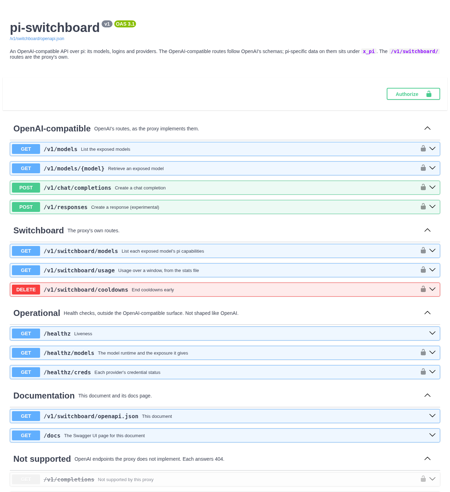

# API reference: the OpenAPI document and the docs page

The proxy describes its whole API as an [OpenAPI 3.1](https://spec.openapis.org/oas/v3.1.0) document, and can serve it as a browsable [Swagger UI](https://swagger.io/tools/swagger-ui/) page where you can send requests. For what each OpenAI field means, [OpenAI's API reference](https://platform.openai.com/docs/api-reference/chat/create) stays the primary documentation; this document says which of them the proxy takes, and what it answers ([The HTTP API](api.md)).

## The document

`GET /v1/switchboard/openapi.json` describes every route the proxy serves: each request and response schema, every error status, and the bearer token. A test compares it with the route table, so it can't leave a route out. The same document is committed as [`openapi.json`](../openapi.json), so a change to the API shows up in a pull request's diff.

```bash
curl -s http://127.0.0.1:4141/v1/switchboard/openapi.json | jq '.paths | keys'
```

Its routes are grouped by tag:

| Tag | Routes |
|---|---|
| **OpenAI-compatible** | `GET /v1/models`, `GET /v1/models/{model}`, `POST /v1/chat/completions`, and `POST /v1/responses` (experimental) |
| **Switchboard** | The proxy's own routes: `GET /v1/switchboard/models`, `GET /v1/switchboard/usage`, `DELETE /v1/switchboard/cooldowns` |
| **Operational** | The health checks: `/healthz`, `/healthz/models`, `/healthz/creds` |
| **Documentation** | The document itself and the docs page |
| **Not supported** | OpenAI endpoints the proxy doesn't implement, each answering `404`: completions, embeddings, audio, images, assistants, threads, files, batches, fine-tuning, and the Responses API's operations on stored responses (`/v1/responses/{id}` and below) |

- **Version.** `info.version` is the API's version, `v1`, the one in every path, not the package's: a release doesn't change the document.
- **Auth.** The bearer scheme is registered as `proxyAuth`, and every route but `/healthz`, the document and the docs page requires it.
- **No `servers`.** The document names no server, because the address is yours. A tool that imports it needs the base URL, `http://127.0.0.1:4141` by default; the docs page uses the address it was opened at.

## Using it in other tools

- **Postman or Insomnia:** import the document by its URL, set the base URL, and set the bearer token on the collection.
- **A generated client:** any OpenAPI 3.1 generator works from the URL, for example `npx @openapitools/openapi-generator-cli generate -i http://127.0.0.1:4141/v1/switchboard/openapi.json -g python -o pi-switchboard-client`. For the OpenAI-compatible routes an OpenAI SDK pointed at `http://127.0.0.1:4141/v1` is the better client; a generated one is most useful for the `/v1/switchboard/` routes.
- **Checking a change:** compare two versions of `openapi.json` with an OpenAPI diff tool to see what a release changed.

## The docs page



`/docs` is off by default. Turn it on with any of these, then open `http://127.0.0.1:4141/docs` in a browser:

| Install | How |
|---|---|
| Any | `--docs-ui`, `PI_SWITCHBOARD_DOCS_UI=true`, or `"docsUi": true` in `proxy-config.json` ([Configuration](configuration.md#every-setting)) |
| pi package | The settings panel (`/proxy config`), then restart the proxy |
| Docker | `"docsUi": true` in the volume's `proxy-config.json`, or `PI_SWITCHBOARD_DOCS_UI` in a `compose.override.yaml`, then `docker compose restart` ([Docker](docker.md#configuration)) |

While it's off, `/docs` answers `404` with a message saying how to turn it on.

- **Authorize first.** With proxy auth on, click **Authorize** and enter the token. The page then sends it with every request it makes.
- **"Try it out" sends real requests.** A chat completion from the page reaches the provider like any other: it spends your quota, can fall back along an alias's chain, and shows up in the logs and the stats. Set `stream` to `false` to read an answer as one JSON body.
- **The browser needs internet access.** The page loads Swagger UI 5.34.0, pinned, from the jsDelivr CDN (`swagger-ui-bundle.js` and its stylesheet) rather than shipping it with the proxy, so a browser that can't reach `cdn.jsdelivr.net` shows a blank page. That outside dependency is why it is off by default.

## Why neither needs the token

The document and the docs page are open even with proxy auth on: a browser can't send a bearer token to open a page, and a tool needs the document to know how to authenticate at all. Both name routes and schemas only, never a model, a provider or a credential, and every route they describe still needs the token. They are two of the three paths that skip proxy auth, with `/healthz`.

## For contributors

The document is built from the routes themselves (each route's `describeRoute`, through [hono-openapi](https://github.com/rhinobase/hono-openapi)), once, on its first request. `test/integration/openapi-document.test.ts` checks it against the committed `openapi.json`. After a deliberate change to the API, `vp test -u` rewrites the file, and the change is reviewed as part of the diff. Separately, `test/integration/openai-spec.test.ts` checks the OpenAI-compatible routes against OpenAI's own published spec ([CONTRIBUTING.md](../CONTRIBUTING.md)).
