# Architecture

One process serves the API. A request passes through the HTTP layer to routing, which picks the model and the login, and pi's SDK calls the provider with pi's own credentials. pi's agent directory holds what the process reads and keeps: pi's logins and models, the proxy's `proxy-config.json`, and the stats file. The console, when the proxy runs as `pi-switchboard tui`, is the same process: it reads the live state and writes the config.

<picture>
  <source media="(prefers-color-scheme: dark)" srcset="diagrams/architecture-dark.svg">
  
</picture>

## A chat request, end to end

Before any provider is called, a chat request is checked and its route planned: the body size limit, proxy auth and strict validation, then a model or alias the exposure config exposes, the candidates it may run on (an alias's targets, each under every login), and a login pi can resolve for them. A request that fails any of these is answered at once and counted as rejected. The rest call the candidates in order through pi. A failure before the answer started moves to the next candidate only when the alias's `fallbackOn`, or `routing.logins.fallbackOn` between logins, names its class ([Routing](routing.md)).

<picture>
  <source media="(prefers-color-scheme: dark)" srcset="diagrams/chat-request-dark.svg">
  
</picture>

## Where the numbers come from

Every request is recorded in memory as it happens: the HTTP requests, the chat requests with their models and timings, and the totals per route. The console reads these live, and the stats recorder writes them to `pi-switchboard-stats.sqlite` every 5 seconds, kept 30 days, for the Stats view and `GET /v1/switchboard/usage`. Provider answers feed the other store: each subscription's quota windows from its response headers, and the cooldowns a 429, 503 or 529 starts. The console's Accounts view and the health checks and `GET /v1/switchboard/models` read those.

<picture>
  <source media="(prefers-color-scheme: dark)" srcset="diagrams/numbers-dark.svg">
  
</picture>

The diagrams' sources are in [`diagrams/`](diagrams/): an HTML page per diagram and skin, and the SVG exported from it that these pages show.

## Pi SDK layers used

- **`@earendil-works/pi-ai`** — the types `Model`, `Usage`, `AssistantMessageEvent`, `JsonObject`
- **`@earendil-works/pi-coding-agent`** — `ModelRuntime` (credentials, catalog and request auth; completions run through its `streamSimple()`, non-streaming ones read the stream's final message) and `SettingsManager`

Requires Pi 1.x (`^1.4.0`). Pi 1.0 is the first release whose Anthropic client identifies as Claude Code 2.1.280, which Anthropic requires for Opus 5.5 and Fable 5.1; Pi 0.x identified as 2.1.75 and those models were refused.
