# Routing

A request that names a model runs on that model; one that names an alias runs on the alias's targets in turn. Either way each model runs under every login that serves it ([Several logins per provider](logins.md#several-logins-per-provider)), in the order `routing.logins.order` sets and without the logins `routing.logins.disabled` names ([Order and disabled logins](logins.md#order-and-disabled-logins)), so the candidates are the targets, each under each login, in order. The proxy walks them: it skips one that is [cooling down](#cooldowns) or below its [quota reserve](#quota) while a later one can serve, calls the next, and moves on after a failure only when the alias's `fallbackOn` names its class ([Fallback chains](#fallback-chains)), or between two logins of one model, `routing.logins.fallbackOn`.

<picture>
  <source media="(prefers-color-scheme: dark)" srcset="diagrams/routing-dark.svg">
  
</picture>

## Aliases

Most clients only let you pick a model name, so an alias is the routing control every client has. Define names in `proxy-config.json`, each pointing at an exposed model's canonical ID:

```json
{ "aliases": { "coding": "anthropic/claude-opus-5-5", "cheap": "anthropic/claude-haiku-5-5" } }
```

- **Request it like a model.** `"model": "coding"` is answered by `anthropic/claude-opus-5-5`. The response's `model` is the target's canonical ID, so you see which model answered, and `x_pi.alias` is `coding`, in a non-streamed response and in every stream chunk. The request log line names the alias too.
- **Listed beside the models.** `coding` appears in `GET /v1/models` (with the target's provider as `owned_by`), in `GET /v1/models/coding`, and in `GET /v1/switchboard/models` with the target's `reasoning_efforts` (or the one effort the alias sets, [below](#reasoning-effort-per-alias)).
- **Only while its target is exposed.** An alias never reaches a model the exposure config hides: leave the target out of `enabledModels` (or `customModels`) and the alias disappears too. `/healthz/models` then lists it as `target-not-exposed`.
- **Never shadows a model.** An alias named like an exposed model's public or canonical ID is ignored, and the model keeps its name. `/healthz/models` answers `503` and lists it as `shadows-model`, and the proxy logs a warning. Rename the alias.
- **Used as written.** Names and targets are not trimmed or normalized; a mistyped target matches no model. An entry with an empty name or target is dropped with the config warning.
- **Edited in the console.** `pi-switchboard tui`'s Models view (`4`) creates, edits and deletes aliases ([The console](console.md#the-console-logs-logins-and-status-at-a-terminal)). **In pi,** `/proxy show` lists the aliases and any left out; editing them in pi's settings panel can come later.

## Fallback chains

An alias can name several models, tried in order, and the failures that move to the next one. `fallbackOn` is required: the proxy falls back only on what you list.

```json
{ "aliases": { "coding": {
  "targets": ["anthropic/claude-opus-5-5", "openai-codex/gpt-6-sol", "github-copilot/claude-sonnet-5-5"],
  "fallbackOn": ["rate_limit", "unavailable", "timeout"]
} } }
```

| Class | Failure before the response starts |
|---|---|
| `rate_limit` | 429, or a usage limit (a ChatGPT login's Codex limit); the client sees `rate_limit` or `insufficient_quota` ([API](api.md)), routing treats both the same |
| `unavailable` | 503, 529 overloaded, or a provider saying it is out of capacity |
| `timeout` | 504, or the upstream idle timeout |
| `auth` | The credential fails (the provider's 401 or 403, or no credential pi can resolve: `502` `upstream_credentials_missing`) |
| `refused` | The login can't run the model (`404 model_not_found`) |
| `upstream_error` | Any other upstream failure, a network failure included |

- **Never on the request's own fault, or once the answer has started.** A `400`, the client leaving, and a failure after a stream sent its first byte are answered as they are without a chain. After the last target, the client gets that target's failure.
- **Visible.** The response's `model` is the model that answered. `x_pi.attempts` lists each model tried before it and why it failed (`[{ "model": "anthropic/claude-opus-5-5", "reason": "rate_limit" }]`), in a non-streamed response and in every stream chunk. Each hop is a warning in the log, naming the alias, the model, the class and the next model. Each upstream call's log lines (`pi.complete`; the result line, with its tokens and cost, is at `debug`) carry the `alias` (`null` for a request that named a model) and the call's `attempt` number, so a log tool can add up usage by route.
- **Exposed targets only.** A target the exposure config hides is skipped (and listed in `/healthz/models` as `target-not-exposed`). The alias is listed while one target is exposed, as the first exposed one.
- **Targets as written.** A target listed twice is tried twice, which is a retry of the same model. `targets` needs at least one entry.
- **Images go to a model that takes them.** An image request skips the chain's text-only models when another one accepts images.
- **No fallback with your own key.** A request with `X-Switchboard-Upstream-Api-Key` runs on the first target only: the key is one provider's.
- **No opt-out per request.** To avoid a chain, name the model directly (its canonical ID); for a shorter chain, define another alias.
- **Timeouts add up.** The upstream idle timeout applies to each attempt, so a three-model chain can wait up to three timeouts before failing.

## Reasoning effort per alias

A team picks a model by job, and the job settles how hard it thinks as well: a reviewer is Opus at `high`, a builder Sonnet at `medium`. A target can set the effort it runs at, as `{ "model", "reasoningEffort" }`, alone or as an entry of `targets`:

```json
{ "aliases": {
  "reviewer": { "model": "anthropic/claude-opus-5-5", "reasoningEffort": "high" },
  "builder": { "model": "anthropic/claude-sonnet-5-5", "reasoningEffort": "medium" },
  "builder-high": {
    "targets": [
      { "model": "anthropic/claude-opus-5-5", "reasoningEffort": "high" },
      { "model": "anthropic/claude-sonnet-5-5", "reasoningEffort": "high" }
    ],
    "fallbackOn": ["rate_limit", "unavailable"]
  }
} }
```

- **The alias's effort wins.** A request naming `reviewer` runs Opus at `high`, whatever `reasoning_effort` it sent. Each target of a chain runs at its own effort, because effort ladders differ by model. A target written as a plain ID keeps the request's effort, clamped as for a model named directly.
- **Reported.** The response carries `x_pi.reasoning_effort: { "requested": "low", "applied": "high" }`, in the body and every stream chunk; `requested` is `null` when the request sent none. Each `x_pi.attempts` entry carries the `reasoning_effort` its target set. The request log line adds `reasoningEffort` and `aliasEffort`, and replacing a different value the client sent is logged at `info` the first time per alias, then at `debug`.
- **An effort the model doesn't support is a mistake in the config, not a clamp.** That target is left out: `/healthz/models` answers `503` and lists it as `effort-unsupported`, and the proxy logs a warning. A chain keeps its other targets, and the alias is dropped only when none is left. `GET /v1/switchboard/models` lists each model's supported efforts.
- **Listed as fixed.** In `GET /v1/switchboard/models`, such an alias's `reasoning_efforts` is just its effort, and `reasoning_effort_fixed` is `true`.
- **Names.** These examples use lowercase kebab-case; the config takes any name exactly as written.

## Family aliases: follow the newest model

A plain alias names one model, so a new model means editing it. A family alias names a family instead, and the proxy follows its newest model. Every family your exposed models belong to has one built in, with no config: `opus-latest`, `sonnet-latest`, `haiku-latest`, `fable-latest`, `sol-latest`, `luna-latest` and so on, listed in `GET /v1/models` after your own aliases.

```
$ curl -s localhost:4141/v1/chat/completions -d '{"model":"opus-latest","messages":[…]}'
{ "model": "anthropic/claude-opus-5-5", …, "x_pi": { "alias": "opus-latest" } }
```

Write one yourself for another name, an effort, or a pin; one named like a built-in alias replaces it:

```json
{ "aliases": {
  "codex-sol-high": { "family": "openai-codex/sol", "reasoningEffort": "high" },
  "opus-steady": { "family": "anthropic/claude-opus", "pin": "anthropic/claude-opus-5" }
} }
```

- **Families are read from the model IDs.** A provider and a tier: Anthropic's `claude-{tier}-{version}` (`anthropic/claude-opus`, `anthropic/claude-sonnet`, …) and Codex's `gpt-{version}-{tier}` (`openai-codex/sol`, `openai-codex/luna`, …). A tier new to pi's catalogue is a family, with its `-latest` alias, as soon as pi lists it. You can't write a pattern. A provider the proxy has no rule for (only Anthropic and OpenAI Codex have one), a tier not written like that provider's, or one none of its models names while you're logged in to it (a typo such as `anthropic/claude-opsu`) is ignored, and `/healthz/models` answers `503` with `family-unknown`. Without a login to the provider the tier can't be checked, and the alias is only `target-not-exposed`.
- **Built-in aliases.** One for each family with an exposed model it can pick, so a provider you have no login for adds none. One named like an exposed model gives way to the model. To change one (another effort, a pin), add an alias of its name; deleting yours brings the built-in one back.
- **Newest by the version in the ID.** pi's catalogue has no release dates, so the proxy reads the version from the model ID: `claude-opus-5-5` is newer than `claude-opus-5` and `claude-opus-4-8`; `gpt-6.1-sol` is newer than `gpt-6-sol`. A dated snapshot (`claude-opus-4-5-20251101`) is never picked over its undated ID. A model in the family whose version can't be read is never picked, and is listed in `/healthz/models` as `family-unparsed`.
- **Among the exposed models only.** If the newest is hidden by the exposure config, the alias follows the newest exposed one, and `/healthz/models` names the hidden one (`newerHidden`). A family with nothing exposed is `target-not-exposed`.
- **It moves by itself, loudly.** It is resolved on every request, so a catalogue update, a login or a logout moves it on the next request, with no restart. Each move is logged once at `warning`, with the old and the new model. `/healthz/models` lists what each family alias resolves to (`familyAliases`), and the console's Models view shows it.
- **`pin` holds it** on one model of the family until you clear it (the console's **Pin to…** and **Follow newest**; on a built-in alias, **Pin to…** saves an alias of its name). A pinned alias never moves; while its pin is hidden or logged out, it is `target-not-exposed`, never the newest instead. A pin outside the family answers `503` with `pin-outside-family`.
- **Like any alias otherwise.** The response's `model` is the model that answered and `x_pi.alias` the family alias. A family can set a `reasoningEffort` ([above](#reasoning-effort-per-alias)), checked against the model it resolves to, and can be one entry of a chain's `targets`.

## Cooldowns

A provider that answers 429 is cooled down, so a chain stops calling it first on every request.

- **What cools.** A `429` cools the login that met it, every model it serves: a subscription's limit covers the account. A provider's other logins (`anthropic-2`, see [Several logins per provider](logins.md#several-logins-per-provider)) keep serving. A `503` or `529` cools only that model.
- **For how long.** As long as the failed response says: `retry-after-ms` or `retry-after`, a body field such as Codex's `resets_in_seconds` or `resets_at`, OpenAI's `x-ratelimit-reset-*` or Anthropic's `anthropic-ratelimit-*-reset` headers, or the message's own words ("try again in 20s"). There is no cap, so a weekly limit cools the provider until it resets. When the response gives no time, the cooldown grows: 60 s, then 180 s, then doubling (360 s, 720 s, …) for each failure in a row. A stated time or a success starts it over. Google's API doesn't let the proxy read the response, so Google models always use the growing default. The proxy calls Codex over SSE rather than pi's default WebSocket, so that it can read Codex's response (#185); a Codex usage limit cools the login like any other provider's 429, and the client gets `429` `insufficient_quota` ([The HTTP API](api.md#api-compatibility), #199).
- **Who skips.** Only a chain whose `fallbackOn` names the class (`rate_limit` for a 429, `unavailable` for a 503 or 529) skips a cooling model. A request that names the model, or a chain that names neither, still calls it. When every model left in the chain is cooling, the one whose cooldown ends first is called.
- **Visible.** A skipped model is listed in `x_pi.attempts` with `"skipped": true` and the reason; the log has a line for each cooldown that starts, ends or is skipped. `/healthz/models` lists the active ones (`scope`, `provider`, `model`, `reason`, `until` as an ISO 8601 time, `secondsLeft`, and `source`: `response` when the failed response gave the time, `backoff` for the growing default), and `/v1/switchboard/models` gives each model's `cooldown` (`reason`, `scope`, `until` in Unix seconds), so a client can pick another model or wait.
- **Ended early by a success.** A call to the provider or model that succeeds clears its cooldown, if the call was sent after the cooldown started. Cooldowns live in memory: a restart forgets them. A request that sends its own key (`X-Switchboard-Upstream-Api-Key`) neither starts nor clears one, as it isn't using the proxy's login.
- **Ended early by you.** When you know a limit has lifted (you bought more, the account was reset) or a provider sent a wrong time, `DELETE /v1/switchboard/cooldowns` (proxy token, if set) ends cooldowns without a restart, and so does `c` in the console. With no query it ends all of them; `?provider=` names a login (`anthropic`, `anthropic-2`) and ends its 429 cooldown; `?model=` names a model, canonical or public ID, and ends its own 503/529 cooldown, not its login's; both together end both. It answers `{ "object": "list", "data": [...] }` with the cooldowns it ended, each in the shape `/healthz/models` lists them; a known name with nothing cooling gets an empty list, and a name that is neither exposed nor cooling down is a `404` (`login_not_found`, `model_not_found`). The next failure without a time waits 60 s again, and the log has a line for each cooldown ended.

  ```bash
  curl -s -X DELETE "http://localhost:4141/v1/switchboard/cooldowns?provider=anthropic-2" -H "Authorization: Bearer $PI_SWITCHBOARD_AUTH_TOKEN"
  ```

- **No hidden retries.** pi calls each provider once per attempt (the provider SDKs' own retries are off), so a 429 reaches the proxy at once and the chain moves on without waiting.

## Quota

Subscriptions report on every response how much of each usage window the account has used. The proxy keeps the latest report per login and shows it on `/healthz/creds` and, per model and per login, on `/v1/switchboard/models` (below, with Unix-second times; `/healthz/creds` gives the same fields in camelCase with ISO 8601 times). A client can check whether a model has room before starting a long run, without making a call.

```json
"quota": { "observed_at": 1792622040, "status": "allowed", "plan": null, "windows": [
  { "name": "5h", "used": 0, "resets_at": 1792639800, "window_minutes": 300, "status": "allowed" },
  { "name": "7d", "used": 0.47, "resets_at": 1792893600, "window_minutes": 10080, "status": "allowed" }] }
```

- **Who reports.** Anthropic subscriptions (`5h` and `7d` windows) and ChatGPT plans signed in as **OpenAI Codex (legacy)** (`openai-codex`: `primary`, 5 hours, and `secondary`, 7 days). A ChatGPT plan signed in through pi 1.4's **OpenAI** login ("Sign in with ChatGPT") reports nothing: OpenAI sends no quota headers on that route (recorded 2026-10-28), so it shows `null` and a reserve never skips it. Google and API-key logins report nothing either, and show `null`.
- **`used`** is the share of the window used, from 0 to 1. A window that has reset since is left out, and a provider with nothing left to show is `null` until its next response.
- **Only the shared login.** A request that sends its own key records nothing. Only the window fields, status and plan are kept, never an account or organization ID.
- **Keep some in reserve.** A fallback chain can skip a provider before it runs out. Set the share of each window to keep free, per provider, in `proxy-config.json`:

  ```json
  { "routing": { "reserve": { "anthropic": 0.2, "openai-codex": 0.1 } } }
  ```

  - **The worse window decides.** With 20% reserved, Anthropic is skipped once either its 5-hour or its 7-day window has less than 20% left.
  - **Between candidates only.** A request with one candidate is always sent. The candidates are an alias chain's models and a model's [logins](logins.md#several-logins-per-provider): with `{ "anthropic": 0.2 }`, a request for `claude-opus-5-5` goes to `anthropic-2` while `anthropic` has less than 20% left, even without an alias. A reserve is keyed by login, so each login can have its own.
  - **Never skips them all.** When every remaining target is below its reserve, the one with the most left is called, so a reserve never fails a request by itself.
  - **Needs a report.** A provider that has reported no quota yet, or never does (Google, API keys), is never skipped.
  - **Visible.** A skip is listed in `x_pi.attempts` as `{ "model": "anthropic/claude-opus-5-5", "reason": "quota", "skipped": true }` and logged at info with the provider, the window and the share left. The console's Accounts view marks a provider `below reserve`.
